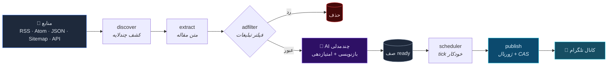
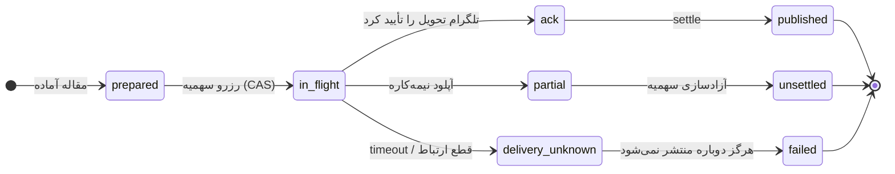

<div align="center">


<br>

[](https://github.com/Aryasamadi/Bot-Official-Telegram-/actions/workflows/ci.yml)
[](https://www.python.org/)
[](https://python-telegram-bot.org/)
[](#-پیکربندی)
[](#-پیکربندی)
[](#-تستها)
[](#)

**ربات تک‌پروسه‌ای مدیریت خودکار کانال تلگرام** — منابع خبری را می‌خواند، با چند مدل هوش مصنوعی بازنویسی و امتیازدهی می‌کند، و به‌صورت **crash-safe** منتشر می‌کند.

<sub>**English** · A single-process Telegram channel automation bot: multi-layer source discovery, multi-model AI rewriting and scoring, idempotent crash-safe publishing, built-in billing (plans · wallet · discounts · referrals) and a SQLite or Cloudflare D1 backend. [Persian docs below.](#-ویژگیها)</sub>

</div>

---

## 📑 فهرست

<table>
<tr>
<td width="50%" valign="top">

**شروع**
- [✨ ویژگی‌ها](#-ویژگیها)
- [🏗️ معماری](#-معماری)
- [🚀 راه‌اندازی سریع](#-راهاندازی-سریع)
- [⚙️ پیکربندی](#-پیکربندی)

</td>
<td width="50%" valign="top">

**عمق**
- [🧠 چرخهٔ انتشار](#-چرخهٔ-انتشار)
- [🛡️ امنیت](#-امنیت)
- [🧪 تست‌ها](#-تستها)
- [☁️ استقرار](#-استقرار)
- [📁 ساختار پروژه](#-ساختار-پروژه)

</td>
</tr>
</table>

---

## ✨ ویژگی‌ها

<table>
<tr>
<td width="50%" valign="top">

### 🌐 کشف چندلایهٔ منبع
از یک URL ساده شروع می‌کند و خودش مسیر را پیدا می‌کند:
**فید** → **سایت‌مپ** → **لینک‌های HTML** → **API سفارشی**.
پشتیبانی از RSS، Atom، JSON Feed، Sitemap و HTML scraping.

### 🤖 هوش مصنوعی چندمدلی
هر سرویس سازگار با **OpenAI / Anthropic / Gemini**.
- fallback خودکار بین مدل‌ها
- **circuit breaker** با backoff نمایی
- کش پاسخ‌ها با نسخه‌بندی پرامپت
- **بودجهٔ per-article** (نه global) با ایزوله‌ی `ContextVar`
- probe دوره‌ای مدل‌های خراب

### 📣 انتشار idempotent و crash-safe
**ژورنال انتشار** + جدول `posted` تضمین می‌کند هیچ مقاله‌ای دو بار منتشر نشود — حتی اگر پروسه وسط آپلود کشته شود.

</td>
<td width="50%" valign="top">

### 🧾 پرداخت و اشتراک
پلن‌ها، **proration منصفانه**، کیف پول، کد تخفیف، و پرداخت دستی با رسید.
همهٔ عملیات پول **اتمیک** و **بازگشت‌پذیر** است.

### 🤝 سیستم ارجاع ضدسوءاستفاده
خودارجاعی رد می‌شود، معرف ناموجود رد می‌شود — **fail-closed**. پاداش **با هر خرید** فرد دعوت‌شده به معرف
می‌رسد (idempotent per-payment)؛ درصد و سقف مبلغی از **پنل سوپرادمین** قابل تنظیم است.

### ☁️ دو بک‌اند دیتابیس
**SQLite** (پیش‌فرض، سریع، اتمیک) یا **Cloudflare D1** به‌عنوان Source of Truth.
تراکنش‌ها روی D1 با **batch اتمیک** پیاده شده‌اند.

### 🌍 دوزبانه
فارسی و انگلیسی، با بازبومی‌سازی خودکار تنظیمات هر کانال.

### 🔐 کانال اجباری
اتوماسیون فقط برای ادمین‌هایی اجرا می‌شود که عضویت‌شان در کانال اجباری تأیید شده باشد.

</td>
</tr>
</table>

---

## 🏗️ معماری



**نقطهٔ کلیدی معماری:** لایهٔ دیتابیس (`db.py`) تنها جایی است که `sqlite3` را می‌بیند و `net_http.py`
تنها جایی است که `httpx` را — هیچ ماژول دیگری مستقیم به دیتابیس یا HTTP دست نمی‌زند.
اینترفیس دیتابیس یکتا: `q()` / `_trx()` / `gset()` / `gget()`.

---

## 🚀 راه‌اندازی سریع

### ۱. پیش‌نیاز

- **Python 3.12+**
- یک توکن ربات از [@BotFather](https://t.me/BotFather)
- شناسهٔ عددی تلگرام خودتان (برای `SUPER_ADMIN_IDS`)

### ۲. نصب

```bash
git clone https://github.com/Aryasamadi/Bot-Official-Telegram-.git
cd Bot-Official-Telegram-

python3 -m venv .venv
source .venv/bin/activate        # ویندوز: .venv\Scripts\activate

pip install -r requirements.txt
```

### ۳. پیکربندی

```bash
cp .env.example .env
```

حداقلِ لازم برای شروع:

```dotenv
BOT_TOKEN=123456789:AA...        # از BotFather
SUPER_ADMIN_IDS=123456789        # شناسهٔ عددی خودتان
```

### ۴. بررسی سلامت (پیش از اجرا)

```bash
python run.py --check
```

این دستور پیکربندی و دیتابیس را بدون شروع polling اعتبارسنجی می‌کند — همان گیتی که CI و استقرار اجرا می‌کنند.

### ۵. اجرا

```bash
python run.py
```

در لاگ باید ببینید:

```
INFO | پیکربندی سالم | backend=sqlite | ...
INFO | core v4 ready | backend=sqlite | CF KV: local | super: {123456789} | AI×3 FETCH×8 CYCLE×2
INFO | در حال اجرا…
```

> 💡 ربات **تک‌پروسه** است و با `flock` روی فایل قفل، از اجرای دو نمونهٔ هم‌زمان روی یک دیتابیس جلوگیری می‌کند.

---

## ⚙️ پیکربندی

همهٔ متغیرها در `.env` خوانده می‌شوند. فایل کامل: [`.env.example`](.env.example)

<details>
<summary><b>هویت و دیتابیس</b></summary>

| متغیر | پیش‌فرض | توضیح |
|---|---|---|
| `BOT_TOKEN` | — | **الزامی.** توکن BotFather |
| `SUPER_ADMIN_IDS` | — | **الزامی.** شناسه‌های عددی، جدا با کاما |
| `DB_BACKEND` | `sqlite` | `sqlite` یا `d1` |
| `DB_FILE` | `newsbot.db` | مسیر فایل (حالت sqlite) |
| `CF_ACCOUNT_ID` | — | لازم برای `d1` |
| `CF_D1_DATABASE_ID` | — | لازم برای `d1` |
| `CF_D1_TOKEN` | — | لازم برای `d1` |

</details>

<details>
<summary><b>نگهداری داده و زمان</b></summary>

| متغیر | پیش‌فرض | توضیح |
|---|---|---|
| `DATA_TTL_HOURS` | `72` | عمر داده‌های کاری |
| `DEDUP_TTL_HOURS` | `72` | عمر اثر انگشت‌های تکرارگیری |
| `DEEPLINK_TTL_DAYS` | `30` | عمر لینک‌های عمیق |
| `DEFAULT_UTC_OFFSET` | `3.5` | منطقهٔ زمانی پیش‌فرض |

> **محتوای منتشرشده هرگز حذف نمی‌شود** — فقط داده‌های کاریِ منتشرنشده پاک‌سازی می‌شوند.

</details>

<details>
<summary><b>هوش مصنوعی</b></summary>

| متغیر | پیش‌فرض | توضیح |
|---|---|---|
| `AI_CONCURRENCY` | `3` | تعداد فراخوانی هم‌زمان |
| `AI_INPUT_TEXT_CHARS` | `8000` | متن ورودی به مدل |
| `AI_MAX_CALLS_PER_ARTICLE` | `12` | سقف فراخوانی برای هر مقاله |
| `AI_ARTICLE_TIME_BUDGET` | `240` | بودجهٔ زمانی هر مقاله (ثانیه) |
| `AI_MAX_MODEL_ATTEMPTS` | `6` | سقف تلاش روی مدل‌ها |
| `AI_CACHE_TTL_DAYS` | `14` | عمر کش پاسخ |

</details>

<details>
<summary><b>هم‌زمانی و زمان‌بندی</b></summary>

| متغیر | پیش‌فرض | توضیح |
|---|---|---|
| `TICK_SECONDS` | `120` | فاصلهٔ tick زمان‌بند |
| `FETCH_CONCURRENCY` | `8` | هم‌زمانی واکشی منابع |
| `CYCLE_CONCURRENCY` | `2` | هم‌زمانی چرخه‌ها |
| `MAX_CYCLES_PER_TICK` | `4` | سقف چرخه در هر tick |
| `MAX_QUEUE_SIZE` | `500` | سقف صف ready (backpressure) |
| `RECOVER_EVERY_MIN` | `5` | فاصلهٔ بازیابی انتشارهای ناتمام |

</details>

<details>
<summary><b>ارجاع، کانال اجباری و سقف‌ها</b></summary>

| متغیر | پیش‌فرض | توضیح |
|---|---|---|
| `REFERRAL_ENABLED` | `1` | فعال‌بودن سیستم ارجاع |
| `REFERRAL_PERCENT` | `10` | درصد پیش‌فرض پاداش هر خرید (۰..۵۰) — از پنل سوپرادمین هم قابل تغییر |
| `REFERRAL_MAX_PER_USER` | منسوخ | سقف «تعداد» حذف شد؛ سقف مبلغی اکنون در پنل → «🤝 ارجاع» |
| `SECRETS_KEY` | — | رمزنگاری کلیدهای AI در حالت سکون (Fernet) |
| `MANDATORY_CHANNEL_ID` | — | کانال اجباری ادمین‌ها |
| `MANDATORY_CHANNEL_USERNAME` | — | جایگزین یوزرنیم |
| `MAX_DAILY_POSTS_CAP` | `500` | سقف پست روزانه |
| `MAX_MEDIA_MB` | `50` | سقف حجم مدیا |
| `MAX_ARTICLE_PAGES` | `5` | سقف صفحه در هر مقاله |

</details>

<details>
<summary><b>اختیاری — Cloudflare KV و Bot API محلی</b></summary>

| متغیر | توضیح |
|---|---|
| `CF_ACCOUNT_ID` | آی‌دی حساب Cloudflare (برای KV **و** D1) |
| `CF_KV_NAMESPACE_ID` | آینهٔ «بیشتر» روی KV (هر سه مقدار CF لازم است) |
| `CF_API_TOKEN` | توکن API کلادفلر (برای KV) |
| `TELEGRAM_API_BASE` | سرور Bot API محلی → آپلود تا ۲۰۰۰MB (≈۲GB؛ پیش‌فرض ۵۰MB) |
| `ALLOW_PRIVATE_MODEL_HOSTS` | فقط برای مدل‌های محلی مثل Ollama |

</details>

---

## 🧠 چرخهٔ انتشار

حساس‌ترین بخش سیستم. هر مقاله یک **ژورنال** دارد و ماشین حالت زیر تضمین می‌کند
تحویل نامعلوم هرگز به پست تکراری تبدیل نشود:



| حالت | معنا | اقدام بازیابی |
|---|---|---|
| `prepared` | مقاله در صف است | ادامهٔ عادی |
| `in_flight` | رزرو شده، تحویل نامعلوم | **هرگز republish** → `failed` |
| `partial` | کرش وسط آپلود | آزادسازی سهمیه → `unsettled` |
| `ack` | تحویل تأییدشده | نهایی‌سازی → `published` |
| `delivery_unknown` | قطع ارتباط با تلگرام | `failed` (محافظه‌کارانه) |

> بازیابی **idempotent** است — اجرای چندباره وضعیت را خراب نمی‌کند.

---

## 🛡️ امنیت

<table>
<tr>
<td width="50%" valign="top">

### دفاع SSRF
هر URL پیش از واکشی اعتبارسنجی می‌شود:
- DNS resolution + بررسی `is_global` روی **هر** IP برگشتی
- رد همهٔ نمایش‌های جایگزین loopback:
  `2130706433` · `0x7f000001` · `127.1` · `0` · `127.0.0.1.nip.io`
- فقط طرح‌های `http` / `https`
- **fail-closed** — هر شک ⇒ رد

</td>
<td width="50%" valign="top">

### دفاع تزریق پرامپت
متن منبع **دادهٔ غیرقابل‌اعتماد** است:
- جعبهٔ `<article_data>` با مرز سخت
- خنثی‌سازی ۶+ شکل تگ بسته
- تشخیص الگوهای `ignore previous instructions`
- پاک‌سازی باقی‌ماندهٔ تزریق روی خروجی مدل

### ماسک رازها در لاگ
توکن ربات، `Bearer`، کلیدهای API، `sk-…`، `AIza…`، و **همهٔ** جفت‌های حساس در query-string.

### محافظت از رازها
`.gitignore` فایل `.env` و `*.db` را مسدود می‌کند. با تنظیم `SECRETS_KEY` کلیدهای AI **رمزنگاری‌شده**
(Fernet) در دیتابیس ذخیره می‌شوند؛ فایل دیتابیس SQLite هنگام ساخت `chmod 600` می‌گیرد (`db.py`).

</td>
</tr>
</table>

---

## 🧪 تست‌ها

```bash
pytest -q                              # ۴۱۵ تست
python -m pyflakes newsbot tools run.py tests   # نگهبان ایستا
python tools/final_verification.py     # راستی‌آزمایی مستقل (۱۷ بررسی)
```

| مجموعهٔ تست | چه چیزی را قفل می‌کند |
|---|---|
| `test_agent_contract.py` | **قرارداد بایت‌به‌بایت** پرامپت و خروجی ایجنت |
| `test_static_guard.py` | صفر `undefined name` + محافظت `.gitignore` |
| `test_security.py` | SSRF · تزریق پرامپت · XSS (۴۹ تست) |
| `test_trx_atomicity.py` | اتمیک‌بودن تراکنش SQLite و batch روی D1 |
| `test_recovery_concurrency.py` | ژورنال انتشار · قفل‌ها · «هرگز پست تکراری» |
| `test_business_logic.py` | سهمیه · تخفیف · ارجاع (۲۵ تست) |
| `test_data_retention.py` | بقای محتوای منتشرشده |
| `test_ui_routing.py` | همهٔ صفحات پنل بدون کرش |
| `test_deployment.py` | چرخهٔ واقعی پشتیبان → بازگردانی |
| `test_secrets_and_text.py` | ماسک رازها · نرمال‌سازی متن |

> **«تست‌نشده = رد‌شده».** هیچ تستی برای سبز شدن تغییر نکرده و هیچ `except` خالی‌ای خطا را پنهان نمی‌کند.

---

## 📁 ساختار پروژه

```text
newsbot/
├── app.py              # راه‌اندازی · preflight · ثبت handlerها
├── config.py           # همهٔ متغیرهای محیطی (بدون وابستگی داخلی)
├── runtime.py          # state زندهٔ زمان‌اجرا (BOT_USERNAME · notify hooks)
├── secret_store.py     # رمزنگاری کلیدهای AI در حالت سکون (Fernet)
├── db.py               # لایهٔ دیتابیس + _trx اتمیک (SQLite / D1)
├── discover.py         # کشف چندلایهٔ منبع
├── extract.py          # استخراج متن مقاله
├── adfilter.py         # فیلتر تبلیغات
├── generate.py         # ساخت پرامپت · هماهنگی AI
├── ai_models.py        # مدل‌ها · fallback · circuit breaker · کش
├── notify.py           # اعلان مدیر کلان/کاربر (بدون وابستگی تلگرام)
├── text_format.py      # نرمال‌سازی · ضدتزریق · HTML تلگرام
├── timeutils.py        # زمان UTC/محلی · منطقه‌های IANA
├── net_http.py         # HTTP + دفاع SSRF
├── opctx.py            # زمینهٔ عملیات · checkpoint چرخه
├── publish.py          # انتشار · ژورنال · تقسیم پیام
├── core_articles.py    # چرخهٔ عمر مقاله + بازیابی انتشار
├── core_channels.py    # کانال‌ها و تنظیمات
├── core_sources.py     # منابع
├── core_plans.py       # پلن‌ها · proration
├── core_payments.py    # پرداخت · کیف پول
├── core_discounts.py   # کد تخفیف
├── core_referrals.py   # سیستم ارجاع
├── core_users.py       # کاربران · سهمیه
├── scheduler.py        # tick خودکار
├── cycle.py            # چرخهٔ fetch → generate
├── concurrency.py      # قفل‌های per-entity
├── ratelimit.py        # محدودیت نرخ
├── ui_commands.py      # دستورها
├── ui_dispatch.py      # مسیریابی callback
├── ui_inputs.py        # پردازش فرم‌ها/ورودی‌ها (کال‌بک و متن)
├── ui_i18n.py          # متن‌ها (منبع یکتا) · TEXT_KEYS
├── ui_support.py       # هندلر پیام آزاد (survey/receipt)
├── ui_views_*.py       # پنل کاربر · ادمین · سوپرادمین
├── ui_widgets.py       # ویجت‌ها · پیام موقت
└── logutils.py         # لاگ + ماسک رازها
```

---

## ☁️ استقرار

<div align="center">

### 🚀 خودکار (توصیه‌شده)

`push` به `main` → ورک‌فلوی `deploy-vps.yml` خودش بکاپ می‌گیرد، کد را می‌کشد،
`run.py --check` را اجرا می‌کند و اگر سالم بود سرویس را restart می‌کند.

</div>

Secretهای لازم در **Settings → Secrets and variables → Actions**:

| Secret | مقدار |
|---|---|
| `VPS_HOST` | IP یا دامنهٔ VPS |
| `VPS_SSH_PRIVATE_KEY` | کلید خصوصی SSH |

### 🔧 دستی

```bash
cd /opt/bot-ai-automatic

mkdir -p /opt/backups
[ -f newsbot.db ] && cp newsbot.db "/opt/backups/newsbot-$(date +%Y%m%d-%H%M%S).db"

git fetch origin main && git reset --hard origin/main
./.venv/bin/pip install -r requirements.txt
./.venv/bin/python run.py --check          # اگر fail شد، restart نکنید
systemctl restart bot-ai-automatic
systemctl is-active bot-ai-automatic
```

راهنمای کامل (شامل dry-run و rollback): **[`DEPLOY-VPS-UPDATE.md`](DEPLOY-VPS-UPDATE.md)**

### 🐳 Docker

```bash
docker build -f deploy/Dockerfile -t newsbot .
docker run -d --env-file .env -v newsbot-data:/app/data newsbot
```

---

## 📊 مدل داده

<details>
<summary><b>جدول‌های اصلی</b></summary>

| جدول | نقش |
|---|---|
| `users` | کاربران، نقش، پلن، زبان |
| `channels` | کانال‌ها + تنظیمات JSON |
| `sources` | منابع (فید، API، etag، شمارندهٔ خطا) |
| `articles` | مقالات + وضعیت + خروجی نهایی |
| `posted` | اثر انگشت پست‌شده‌ها (ضد تکرار) |
| `pub_journal` | ژورنال انتشار (ماشین حالت) |
| `ai_models` | مدل‌ها، اولویت، وضعیت، backoff |
| `plans` · `pay_requests` · `plan_changes` | اشتراک و پرداخت |
| `discounts` · `referrals` | تخفیف و ارجاع |
| `usage` · `rate_limits` | سهمیه و محدودیت نرخ |

</details>

---

## 🤝 مشارکت

```bash
git checkout -b feature/your-feature
# ... تغییرات ...
pytest -q && python -m pyflakes newsbot tools run.py tests
git commit -m "feat: توضیح کوتاه"
git push origin feature/your-feature
```

قبل از PR این سه گیت باید سبز باشند: `pytest` · `pyflakes` · `run.py --check`.

---

<div align="center">

### 📜 مجوز

این مخزن در حال حاضر فایل مجوز ندارد.
اگر قصد انتشار عمومی دارید، افزودن [MIT](https://choosealicense.com/licenses/mit/) پیشنهاد می‌شود.

<br>

<sub>ساخته‌شده با ❤️ برای مدیریت خودکار کانال‌های خبری</sub>

<br><br>

[⬆ بازگشت به بالا](#)

</div>
